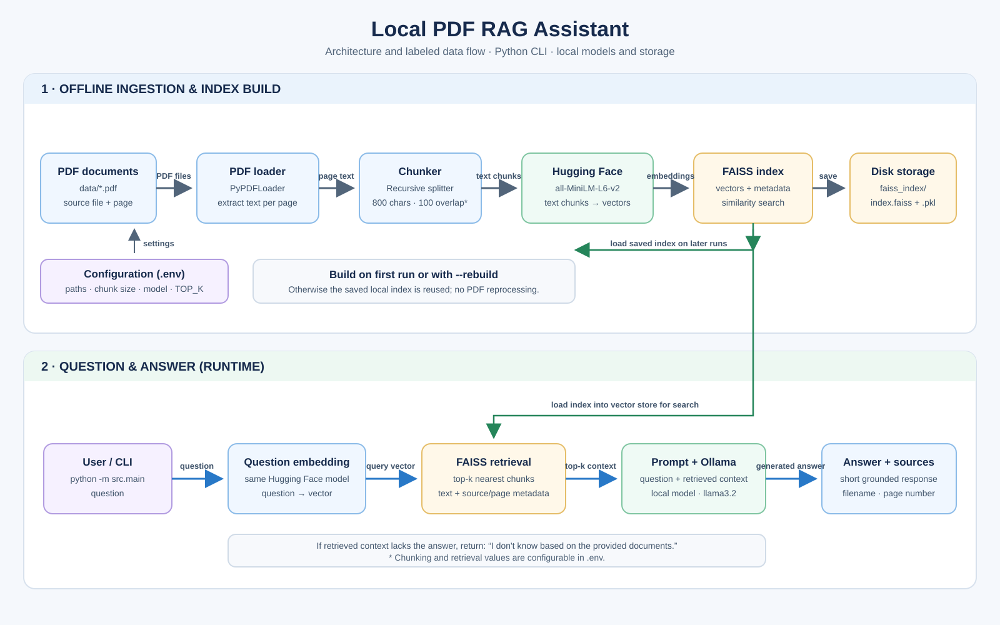

# Enterprise Knowledge Assistant (RAG) POC: Local PDF RAG Assistant

A document Q&A assistant built with LangChain. It uses Hugging Face embeddings to search PDF text with FAISS and Ollama to generate short answers with source citations. No paid API keys are needed.

## Architecture and data flow



```text
PDFs -> chunks -> embeddings -> FAISS -> retriever -> Ollama -> answer + sources
```

## Prerequisites

- Python 3.10 or newer
- [Ollama](https://ollama.com/) installed and running locally

## Setup

From the project directory, create and activate a virtual environment:

```powershell
python -m venv .venv
.\.venv\Scripts\Activate.ps1
```

Install dependencies, create local configuration, and download the default LLM:

```powershell
python -m pip install -r requirements.txt
Copy .env.example .env
ollama pull llama3.2
ollama serve
```

Keep Ollama running in a terminal. On installations where Ollama already runs as a background service, the `ollama serve` command is not needed.

## Add PDFs and build the index

Put one or more `.pdf` files in `data/`. The sample `policy.pdf` is included in this workspace; add your own PDFs there as needed. Build or rebuild the local index:

```powershell
python -m src.main --rebuild
```

The FAISS index is saved in `faiss_index/` and reused on later runs. It is not necessary to rebuild unless the documents or embedding configuration change.

## Usage

Ask one question and exit:

```powershell
python -m src.main --question "How many days of annual leave do I get?"
```

Rebuild the index, then enter interactive Q&A (type `exit` to quit):

```powershell
python -m src.main --rebuild
```

Print the retrieved text passages and their FAISS distance scores:

```powershell
python -m src.main --question "What is the policy on data privacy?" --show-chunks
```

Combine options as needed:

```powershell
python -m src.main --rebuild --question "How many days of annual leave do I get?" --show-chunks
```

## Regression tests and performance evaluation

Run the offline unit tests (the Ollama model is mocked):

```powershell
python -m unittest discover -s tests -v
```

Run live end-to-end checks against the PDFs in `DATA_DIR` and the configured local Ollama model:

```powershell
python -m scripts.evaluate_poc
```

The evaluation tests annual-leave entitlement and carry-forward, work-from-home allowance, password length, and the exact fallback for an unsupported question. It checks expected answer terms and cited pages, and records FAISS build/load time and repeated question latency in `reports/evaluation_report.md`. It builds a temporary index and does not replace the application's saved index.

The report estimates electricity cost from the configured device wattage and INR/kWh rate; these defaults are assumptions, not wall-power measurements. Local Ollama inference has no hosted API charge, but local electricity, hardware, model storage, and model downloads are not free. To compare with your own hosted API rate, provide it explicitly:

```powershell
python -m scripts.evaluate_poc --repeats 3 --power-watts 100 --electricity-rate-inr-per-kwh 8 --cloud-cost-per-1000-requests-inr 50
```

Adjust the wattage, electricity rate, and cloud rate to your actual environment. A cloud comparison is omitted unless a rate is supplied.

### Example questions

- How many days of annual leave do I get?
- What is the policy on data privacy?
- Who should I contact about a policy question?

Example output (the answer depends on the loaded PDFs):

```text
Answer: The policy allows 20 days of annual leave per year.
Sources:
- policy.pdf, page 3
```

## Configuration

Settings are loaded from `.env`. Relative paths are resolved from the project directory.

| Setting | Default | Description |
| --- | --- | --- |
| `DATA_DIR` | `./data` | Directory scanned for PDF files. |
| `INDEX_DIR` | `./faiss_index` | Directory used to save and load the FAISS index. |
| `EMBEDDING_MODEL` | `sentence-transformers/all-MiniLM-L6-v2` | Hugging Face model used to embed chunks and questions. |
| `HF_TOKEN` | *(unset)* | Optional Hugging Face access token, used for gated or private models. |
| `CHUNK_SIZE` | `800` | Maximum chunk length in characters. |
| `CHUNK_OVERLAP` | `100` | Shared characters between adjacent chunks. |
| `TOP_K` | `4` | Number of closest chunks provided to the LLM. |
| `OLLAMA_MODEL` | `llama3.2` | Model name available in your Ollama installation. |
| `OLLAMA_BASE_URL` | `http://localhost:11434` | Local Ollama server URL. |
| `TEMPERATURE` | `0` | LLM sampling temperature, from 0 to 2. |

## How it works

1. The loader finds every PDF in `DATA_DIR` and keeps each page's filename and page metadata.
2. The chunker splits pages into small, overlapping pieces of text.
3. Hugging Face converts each piece into an embedding, and FAISS saves the searchable index locally.
4. For a question, FAISS retrieves the closest text chunks.
5. Ollama receives only those chunks and the question. The answer is kept short and includes the source file and one-based page number.
6. If the context does not contain the answer, the assistant responds: `I don't know based on the provided documents.`

## Troubleshooting

- **Connection refused:** Start Ollama with `ollama serve`, and confirm `OLLAMA_BASE_URL` points to the local server.
- **Model not found:** Download the configured model, for example `ollama pull llama3.2`; check `OLLAMA_MODEL` if you use another model.
- **First run is slow:** The Hugging Face embedding model downloads once, and the initial run builds the FAISS index.
- **Gated Hugging Face model:** Set `HF_TOKEN` in `.env` to a Hugging Face access token with permission to access the model.
- **No PDFs found:** Add `.pdf` files under the configured `DATA_DIR` and rebuild.
- **Empty or unhelpful answers:** Check that the PDF contains extractable text and that it covers the question. Use `--show-chunks` to inspect retrieved passages.
- **Embedding model changed:** Delete the local `faiss_index/` folder and run with `--rebuild`; vectors made by different embedding models cannot be mixed.

## Limitations and next steps

This proof of concept uses local PDF text extraction and basic nearest-neighbor retrieval. Possible improvements include metadata filtering, re-ranking retrieved passages, a managed vector store for larger deployments, and a simple web UI.
